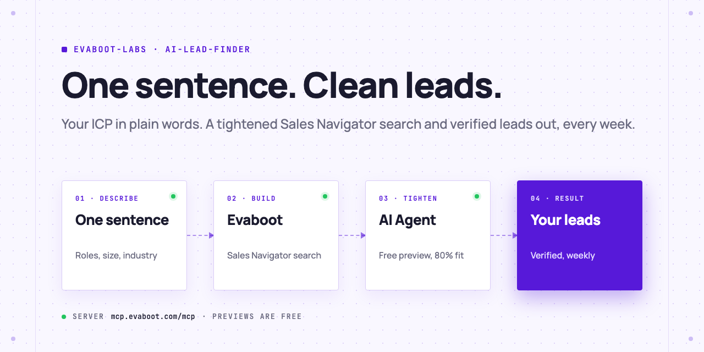
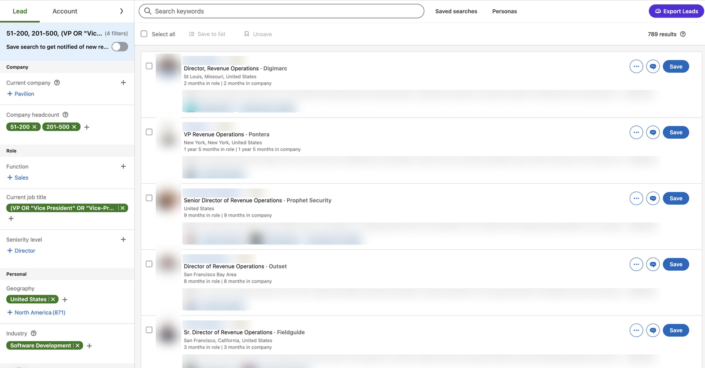
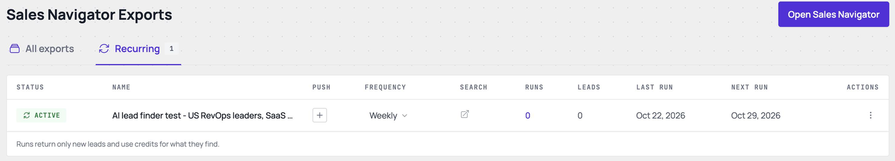
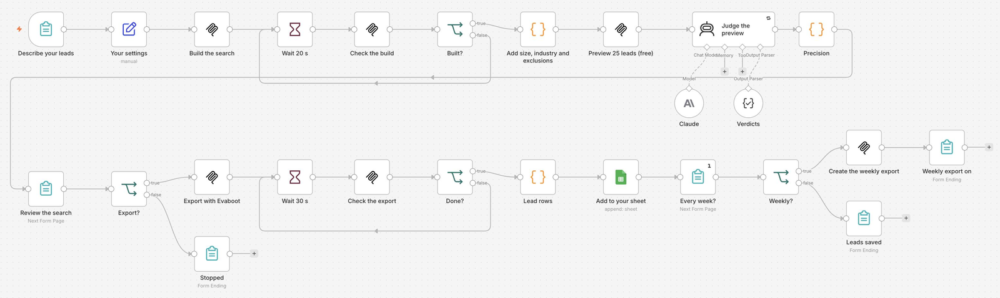

<picture>
  <source media="(prefers-color-scheme: dark)" srcset=".github/assets/banner-dark.png">
  
</picture>

# AI lead finder

Describe the leads you want in one sentence. Your AI Agent builds the Sales Navigator search with Evaboot, judges a free preview of 25 leads, tightens the search until it is clean, exports the leads with verified emails, and repeats it every week.

[](AGENTS.md)
[](https://evaboot.com/mcp)
[](LICENSE)

## Set it up in one prompt

Paste this into Claude Code, Codex or Cursor:

```text
Clone https://github.com/evaboot-labs/ai-lead-finder, read AGENTS.md and follow the skill. Find me 20 leads: RevOps leaders at US SaaS companies of 50 to 500 people.
```

<details>
<summary>Or install the skill</summary>

Claude Code:

```text
/plugin marketplace add evaboot-labs/ai-lead-finder
/plugin install ai-lead-finder@evaboot-labs-ai-lead-finder
```

Codex, Cursor and other agents:

```bash
npx skills add evaboot-labs/ai-lead-finder
```

</details>

## How it works

**1. Previews are free, so the agent tightens before it spends.** Each round previews 25 leads, judges every one against [`TARGET.md`](TARGET.md), and changes one thing until 80% fit.

```text
round  results      fit  change
1       22,993   4/25    one sentence: RevOps, Sales Ops or GTM Ops leaders in the US
2          864  21/25    added industry Software Development and 51-500 employees
3          789  24/25    excluded consultant, advisor, fractional, independent
verdict: ready to export
```



**2. Only then does it export,** with verified emails, and report what you got: 20 leads, 20 emails, 16 safe in our test.

**3. Every week, only new people.** A recurring export repeats the search and returns only the people who are new to it.



**4. Or run it in n8n.** A form takes your sentence, Claude judges the preview, and a review page shows the precision before any credit is spent.



## What you need

- An [Evaboot account](https://dash.evaboot.com/accounts/signup/?last_click_origin=ai-lead-finder-repo) and a Sales Navigator seat.
- An AI Agent that can use an MCP server: Claude Code, Codex, Cursor, or the n8n version.
- Python 3.9+, with no packages to install.
- Cost: previews are free; 1 Evaboot credit per exported lead.

## Go further

| Page | For |
|---|---|
| [docs/connect-your-agent.md](docs/connect-your-agent.md) | The setup by hand, for each agent |
| [docs/n8n.md](docs/n8n.md) | The same finder in n8n, from a form |
| [TARGET.md](TARGET.md) | Who fits, who does not, and the precision target |

---

Agents: start at [AGENTS.md](AGENTS.md) · Built by [Evaboot](https://evaboot.com) · More workflows at [github.com/evaboot-labs](https://github.com/evaboot-labs) · [MIT license](LICENSE)
